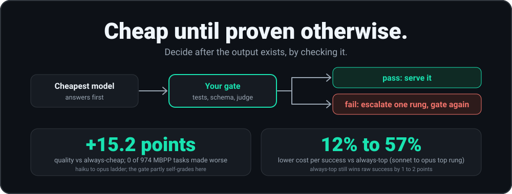
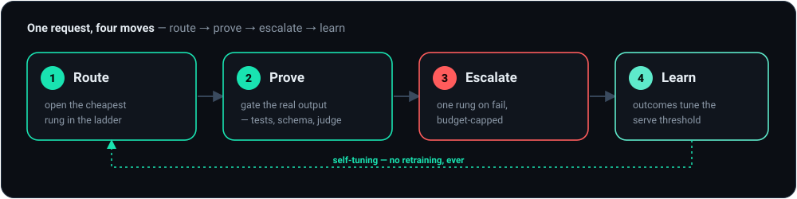
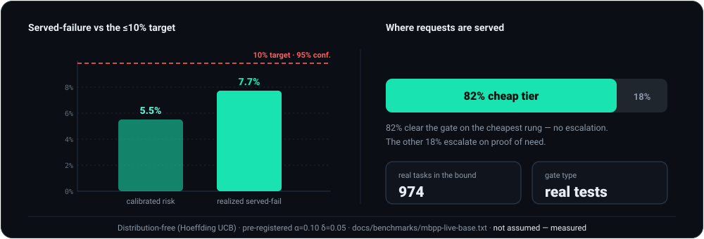
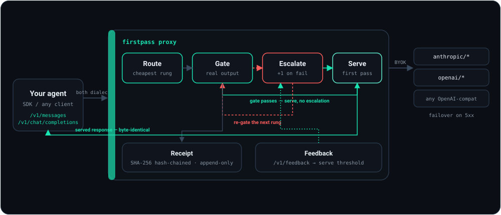
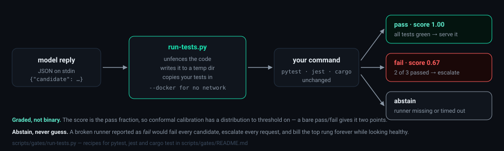
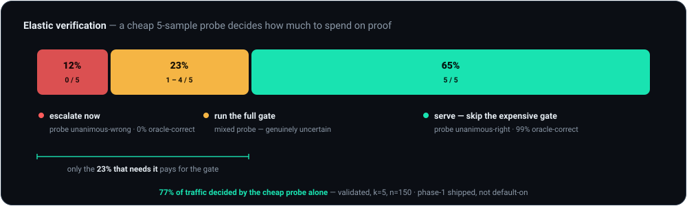

<div align="center">



# Firstpass

### Use the cheap model. Prove the answer. Pay for the big one only when the proof fails.

<p>
<a href="https://github.com/dshakes/firstpass/actions/workflows/ci.yml"></a>
<a href="https://github.com/dshakes/firstpass/releases"></a>
<a href="https://pypi.org/project/firstpass/"></a>
<a href="LICENSE"></a>
<a href="https://github.com/dshakes/firstpass/stargazers"></a>
</p>

**[Website](https://dshakes.github.io/firstpass/)** · **[Guide](https://dshakes.github.io/firstpass/guide/)** · [Install](#install) · [Quickstart](#quickstart) · [Proof](#the-proof) · [Certified selection](#it-says-no-too)

</div>

---

## What it is

Firstpass is an open-source (Apache-2.0, Rust) proxy that sits between your agent and your LLM provider. Every request opens on the cheapest model in your ladder. **Your own check** (tests, a schema, a judge) runs on the real output. Pass, and it is served. Fail, and it escalates one rung and is checked again. Every decision leaves a hash-chained receipt anyone can re-derive.

Adopting it is one environment variable. Leaving is unsetting it.

## The problem

Most model routing decides **before the output exists**: a classifier reads the prompt and guesses, or a gateway picks on price and availability. When the guess is wrong you find out in production, and nothing explains why.

## The insight

The only moment you can answer "is this good enough to serve?" is **after** the answer exists. So Firstpass does not predict. It checks. The cheap model handles what it can prove it handled; the expensive model is spent only when a real check says the cheap answer is not enough. The cost saving is the consequence of that, not the mechanism.

## How it works

<div align="center"></div>

1. **Route.** The request opens on the cheapest rung. No per-prompt classifier picks the model.
2. **Prove.** A gate checks the actual output: your unit tests, a JSON schema, an LLM judge, or self-consistency. A gate that errors abstains; it never passes.
3. **Escalate.** Only on failure: one rung up, budget-capped, then gated again.
4. **The receipt.** Each decision is written to a hash-chained trace that an outside party can re-verify with no proxy and no database in the loop.

<details>
<summary><b>What a receipt looks like</b> (illustrative example, not a measured result)</summary>

```jsonc
{
  "trace_id": "0192f3a1-7c4e-7abc-9d21-4e8b1f0a2c33",
  "prev_hash": "9f2c…a1b7",                          // chains to the prior decision
  "attempts": [
    { "rung": 0, "model": "anthropic/claude-haiku-4-5", "cost_usd": 0.0007,
      "gates": [{ "gate_id": "cargo-test", "verdict": "fail" }] },   // cheap tried first, gate caught it
    { "rung": 1, "model": "anthropic/claude-sonnet-5", "cost_usd": 0.0121,
      "gates": [{ "gate_id": "cargo-test", "verdict": "pass" }] }    // escalated, proven, served
  ],
  "final": { "served_rung": 1, "total_cost_usd": 0.0128,
             "counterfactual_baseline_usd": 0.0630, "savings_usd": 0.0502 }
}
```

`firstpass export` writes the log as JSONL; `firstpass verify --file receipts.jsonl` re-derives the hash chain from genesis. A single altered or reordered receipt breaks the chain at its index and exits non-zero. Downstream outcomes arrive via `POST /v1/feedback` onto a side table that never alters the sealed record.
</details>

<div align="center"></div>

## The proof

All numbers below are from committed artifacts in [`docs/benchmarks/`](docs/benchmarks/). Each one is tied to its dataset and ladder; none is a universal promise.

**Gated escalation beats serving the cheap model alone.** On 974 real MBPP coding tasks (haiku → opus ladder), gating lifted quality by **+15.2 points** over always-cheap (95% CI [+12.9, +17.5]) and made **0 of 974 tasks worse** ([artifact](docs/benchmarks/mbpp-policy-974-opus.txt)). Caveat: on this workload the gate runs asserts that are also shown in the prompt, so it is partly self-grading.

**…at lower cost per success than always-top, if you name the ladder.** **57% lower** with an opus top rung, **12% lower** with a sonnet top rung ([opus](docs/benchmarks/mbpp-policy-974-opus.txt) · [sonnet](docs/benchmarks/mbpp-policy-974.txt)). Always-top still wins on raw success by 1 to 2 points (−2.3 on the opus ladder). A saving without its ladder means nothing.

**A served-failure bound, earned on a real run.** Pre-registered target: at most 10% wrong answers served at 95% confidence (α=0.10, δ=0.05). On 974 MBPP tasks with real test gates the run realized **7.7%** served-failure (calibrated risk 5.5%) while serving **82%** of requests from the cheap tier. The gate's false-accept rate on that run was 14.7%, stated openly. This is one run on one dataset: it shows the bound is computed from your outcomes, not that any deployment is guaranteed 10% ([artifact](docs/benchmarks/mbpp-live-base.txt), [method](https://dshakes.github.io/firstpass/guide/guarantee.html)).

<div align="center"></div>

**Agent workloads: choose the model, not the request.** On 500 real SWE-bench Verified agent runs per model (public leaderboard trajectories), no per-request cascade beat always-top. Choosing one model for the workload by evidence did: 374 vs 384 resolved against always-opus (difference not significant) at **71% lower cost**. One recorded run per model, one scaffold ([numbers](docs/benchmarks/agentic-real-runs.md)).

**Decision-rule replay.** Replaying decision rules on recorded outcomes, the first-pass rule beat judge-escalate and conformal-cascade rules by +3.3 and +5.1 points ([artifact](docs/benchmarks/competitor-headtohead.md)).

Your savings depend on your workload, so every trace records the always-top counterfactual. You measure your number instead of trusting ours.

<details>
<summary><b>Reproduce it</b> (each command labels itself and states what it costs)</summary>

```bash
cargo run -p firstpass-bench                    # simulation harness (free, self-labeled SIMULATION)
cargo run -p firstpass-bench -- --live          # live benchmark (your key)

# the served-failure bound on real MBPP tasks (your key + Docker):
curl -sLO https://raw.githubusercontent.com/google-research/google-research/master/mbpp/mbpp.jsonl
FIRSTPASS_CODING_DATASET=./mbpp.jsonl \
  cargo run --release -p firstpass-bench -- --coding-live
```

The harness recomputes the bound from your run's gate and oracle outcomes with the same pre-registered α and δ. Provenance rules: [`docs/benchmarks/README.md`](docs/benchmarks/README.md).
</details>

## It says no, too

A router that only ever says yes is not a router. Firstpass can test a cheaper model on your own traffic and refuse it. Add a `[route.challenger]`; an anytime-valid e-process, graded by your gates, decides **certified** (no worse than your margin) or **halted** (worse), with error at most alpha however often you look. It never switches models on its own: a halted challenger is stopped automatically, and adopting a certified one is a human config edit. ([ADR 0014](docs/adr/0014-certified-model-selection.md), [evidence](docs/benchmarks/live-certified-selection.md))

We ran it live on real Anthropic calls (about $29.70 total):

- **MBPP, 974 pairs: halted.** sonnet-5 95.4% vs haiku-4-5 84.6%, with haiku at 0.30× the cost per request. The router refused the cheaper model, **halting at pair 137**, and halted in 100 of 100 random orders.
- **APPS, 290 contest problems: undecided.** 65.2% vs 60.7%, with haiku at 0.09× the cost. Undecided in 194 of 200 random orders. That is the right answer: the gap is too close to the margin to call.
- **The live run caught three real bugs in Firstpass itself**, all fixed with tests: a challenger graded on "served" instead of "passed" had falsely certified haiku ([#244](https://github.com/dshakes/firstpass/pull/244)); a halted challenger kept spending ([#245](https://github.com/dshakes/firstpass/pull/245)); a 120 s timeout dropped the 33 longest problems and manufactured a halt ([#246](https://github.com/dshakes/firstpass/pull/246)).

Paired mode (`mode = "paired"`) re-runs the challenger off the hot path on the same request, under its own daily spend cap. In a replay of recorded paid calls it decided after about 76 to 127 requests, against 222 to 425 for live mode (about 3× fewer; [replay](docs/benchmarks/certified-selection.md)).

## Where it fits

Verification needs something to verify against. Firstpass is strongest where "correct" is checkable: code with tests, structured output against a schema, extraction. For open-ended prose the gates are a judge or self-consistency, which are weaker. **If your output has no check, Firstpass is the wrong tool.**

Related approaches and what is borrowed versus new (the verified cascade itself is prior art: FrugalGPT, AutoMix): [docs/related-work.md](docs/related-work.md).

---

## Install

```bash
curl --proto '=https' --tlsv1.2 -LsSf https://github.com/dshakes/firstpass/releases/latest/download/firstpass-proxy-installer.sh | sh
```

| | |
|---|---|
| **pip / uvx** | `pip install firstpass` · `uvx --from firstpass firstpass-proxy` |
| **Homebrew** | `brew install dshakes/tap/firstpass-proxy` |
| **Docker** | `docker run -p 8080:8080 -e FIRSTPASS_BIND=0.0.0.0:8080 ghcr.io/dshakes/firstpass:latest` (published on release tags) |
| **Cargo** | `cargo install firstpass-proxy` (crates.io; needs a Rust toolchain) |
| **Binaries** | macOS, Linux, Windows, checksummed — [Releases](https://github.com/dshakes/firstpass/releases) |

npm is not published; do not `npm i` anything for Firstpass.

## Quickstart

Observe mode changes nothing:

```bash
firstpass-proxy                                     # watches your traffic, touches nothing
export ANTHROPIC_BASE_URL="http://127.0.0.1:8080"   # your agent now routes through firstpass
# use your agent normally; every call gets a receipt: what it would route, what you would save
```

Convinced by your own numbers? Switch on routing:

```bash
cp firstpass.example.toml firstpass.toml
FIRSTPASS_MODE=enforce FIRSTPASS_CONFIG=./firstpass.toml firstpass-proxy
```

Or let Firstpass start the agent already pointed at it (`firstpass launch claude`; also `codex`, or `openai -- <any OpenAI-compatible command>`). It refuses to start if no proxy is listening, or if something that is not Firstpass holds the port.

Leaving is `unset ANTHROPIC_BASE_URL`.

**Let an agent do it.** `firstpass onboard --apply` detects your shell, whether the proxy is running and which agents you have, then does only what is missing. It is idempotent, `firstpass onboard` alone is a dry run, and `firstpass offboard` reverses it. `firstpass kiosk` puts one real request through the ladder and prints the receipt (keyless demo if no key is found). `firstpass handshake` prints one JSON document for callers with no terminal and never writes. `GET /panel` is a live receipts view served by the binary itself. Machine-readable setup: [`llms.txt`](llms.txt), [`AGENTS.md`](AGENTS.md), `GET /v1/capabilities`, `firstpass mcp`.

---

## Architecture

Firstpass is a proxy in front of your provider calls. Your agent keeps its endpoint; the response is byte-identical to the served rung.

<div align="center"></div>

| Endpoint | For |
| --- | --- |
| `POST /v1/messages` | Anthropic Messages (Claude Code and anything Anthropic-native) |
| `POST /v1/chat/completions` | OpenAI Chat Completions and OpenAI-compatible clients |
| `POST /v1/responses` | OpenAI Responses, including tool calls |
| `GET /v1/models` | Model discovery for agent CLIs |

Vendors can be crossed mid-ladder: `reasoning_effort` is carried to Anthropic rungs as `thinking`, and tool calls survive the `/v1/responses` round trip.

### Gates

| Effort | You get |
|---|---|
| **None** (observe mode) | Firstpass reports what it would route and save. Nothing changes. |
| **One sentence** (judge gate) | A second model grades each answer against your plain-English rubric. |
| **One config line** (consistency gate) | The model answers *k* times; agreement is the confidence (self-consistency, Wang et al. 2022). |
| **Your existing tests** | The strongest gate: generated code ships only if your suite passes. |

Built-in gates are `non-empty` and `json-valid`; everything else is a `[[gate]]` block. Flaky gates auto-disable on an error budget. Your test runner becomes a gate via `scripts/gates/run-tests.py` ([Gates](https://dshakes.github.io/firstpass/guide/gates.html#wrapper)).

<div align="center"></div>

### Providers

`anthropic` and `openai` are built in. Eight more OpenAI-compatible platforms need no `[[provider]]` block: `groq`, `deepseek`, `together`, `fireworks`, `mistral`, `openrouter`, `xai`, `cerebras`. Any other OpenAI-compatible host (Azure, an aggregator, your own Ollama or vLLM) needs a `[[provider]]`; Gemini (`dialect = "gemini"`), AWS Bedrock (`auth = "aws_sigv4"`) and Google Vertex (`auth = "gcp_oauth"`) use the same shape. Every variant ships in [`firstpass.example.toml`](firstpass.example.toml), guarded by a parse test.

```toml
[[route]]
mode = "enforce"
ladder = ["groq/llama-3.3-70b-versatile", "anthropic/claude-sonnet-5"]
gates = ["non-empty"]

[[price]]   # required: endpoints ship built in, prices do not
model = "groq/llama-3.3-70b-versatile"
input_per_mtok = 0.59
output_per_mtok = 0.79
```

Prices are deliberately not built in for these platforms: a stale price would write a wrong `cost_usd` into a tamper-evident receipt and mis-feed your `[budget]` caps, so the proxy refuses to start without a `[[price]]` for every rung. `firstpass doctor` fails loudly on a missing API key.

> **Verification status.** The Anthropic path is live-verified end to end. The OpenAI-compatible, Gemini, Bedrock and Vertex adapters are implemented and offline-tested against recorded wire shapes, pending live verification ([roadmap](docs/roadmap.md)).

### Long conversations

- **A prompt too large for the cheap rung escalates** instead of failing; the receipt records `context_overflow` so capacity-forced escalations are not pooled with quality failures.
- **A session that had to escalate starts there next turn** (`[escalation.session_promotion]`), with a periodic downward probe so promotion is never a one-way ratchet.
- **Cached prompts are billed as cached.** All three prompt-caching counters are priced, so receipts and `[budget]` caps see the real cost.
- **A conversation that fits nowhere is condensed rather than refused** (`[escalation.condense]`, off by default), only once every rung has overflowed.

### Certified model selection

The mechanism behind [It says no, too](#it-says-no-too):

```toml
[route.challenger]
ladder  = ["openrouter/minimax-m2.5"]   # what you'd like to switch to
percent = 10                             # % of sessions served by it, randomized per session
```

Post task outcomes to `/v1/feedback`; `firstpass experiment` (also `GET /v1/experiments` and the `/panel` view) reports **certified**, **halted** or **undecided**. The default margin is 5 points. Paired mode needs a real gate; a route whose only gate is `non-empty` is rejected. Halt state is per process and rebuilt from receipts at startup; for a global halt across replicas set `redis_url` under `[route.challenger]` (needs the `redis-cache` Cargo feature). Method and limits: [ADR 0014](docs/adr/0014-certified-model-selection.md).

### Running more than one replica

The verified cache and session promotion are in-process by default, so behind a load balancer a retraction only reaches the replica that got the feedback. Share them through Redis (build with `cargo install firstpass-proxy --features redis-cache`):

```toml
[escalation.verified_cache]
ttl_secs  = 900
redis_url = "redis://cache:6379/0"

[escalation.session_promotion]
after_failures = 2
window         = "30m"
redis_url      = "redis://cache:6379/0"
```

Setting `redis_url` without the feature, or pointing it at an unreachable server, fails at startup rather than silently falling back.

### Modes

`x-firstpass-mode` (or per route / env) selects a profile: `cost`, `balanced`, `quality`, `latency`, `max`. Same ladder, different serve threshold and escalation appetite.

### Under the hood

- **Learned start-rung bandit.** UCB1 or Thompson sampling with discounted Beta posteriors ([ADR 0007](docs/adr/0007-thompson-start-rung.md)). It predicts where to start; the gate still decides what to serve.
- **The bound.** Split-conformal (Hoeffding UCB) or Learn-then-Test exact-binomial testing (`firstpass calibrate --method ltt`), tracked under drift by adaptive conformal. Prometheus gauges: `firstpass_serve_threshold`, `firstpass_realized_served_failure`.
- **Off-policy evaluation.** `firstpass ope` replays your logged receipts against a candidate ladder with IPS / SNIPS / DR estimators and confidence intervals: rehearse a policy change before you ship it.
- **Elastic verification** (validated research, phase-1 shipped, not default-on). A cheap *k*-sample probe decides how much proof to spend ([ADR 0008](docs/adr/0008-elastic-verification.md)). In a validation study (k=5, n=150) unanimous agreement was 99% oracle-correct and the probe alone decided 77% of traffic, with a traffic split of 12% / 23% / 65% ([artifact](docs/benchmarks/probe-study-mbpp.txt)).

<div align="center"></div>

### Decision-model routers (Jev) and the optional prior

Decision models such as TypeSafe's **Jev** answer one cheap closed-form question per query and can pick a model tier directly. Firstpass's position is narrower: **predict the start, verify what is served.** The same cheap signal can choose where the ladder opens, but the gate still runs on every attempt, so a wrong prediction costs money or latency, never an unverified answer.

- **Simulation only:** in Firstpass's own simulation harness (`cargo run -p firstpass-bench`), a Jev-style router that serves unverified output shows a much higher served-failure rate than the gated arm. This is a simulation, not a live result ([ADR 0013](docs/adr/0013-verified-predictive-routing.md)).
- **`[escalation.prior]` is experimental and default-off.** Replaying the prior on real recorded MBPP outcomes across three ladders, with **OpenJev** run locally as the prior source (not TypeSafe's hosted Jev), pooled $/success fell **−4.6%** with served-failure held ([replay](docs/benchmarks/openjev-prior-replay.md)). The win is ladder-dependent and says nothing about hosted Jev's accuracy.
- **Blending a learned signal in was worse** than the prior alone, so the prior alone stays the recommendation ([replay](docs/benchmarks/prior-blend-replay.md)).
- **The `decision` gate is NOT-RECOMMENDED.** Measured with local OpenJev against hidden-test labels on served MBPP answers, it missed the pre-registered bar; hosted Jev is unmeasured ([study](docs/benchmarks/decision-gate-study.md)).

```toml
[escalation.prior]
provider    = "typesafe"                # the only accepted value today
base_url    = "https://api.typesafe.ai" # default; point at a local OpenJev, e.g. http://127.0.0.1:8080
model       = "jev-latest"
api_key_env = "TYPESAFE_API_KEY"        # required even for a keyless local server (set any placeholder)
timeout_ms  = 150                       # any error fails open: no prior
strength    = 10                        # Beta pseudo-count weight of the prior
rungs = [
  "rung 0 (claude-haiku) is the least capable tier that fully handles this request",
  "rung 1 (claude-sonnet) is the least capable tier that fully handles this request",
]
```

`rungs` needs exactly one entry per rung of every `enforce` route's ladder; a mismatch is rejected at parse. Run OpenJev locally ([razorback16/openjev](https://github.com/razorback16/openjev)): `OPENJEV_BACKEND=mlx python -m openjev` on Apple Silicon, or `docker compose up` on NVIDIA. The `decision` gate is `[[gate]] decision = { provider = "typesafe", model = "jev-latest", threshold = 0.6 }`; transport errors or unparseable replies abstain, never pass.

Comparison on method, not marketing (RouteLLM, Not Diamond, Martian, FrugalGPT, AutoMix, CP-Router, and others): [docs/related-work.md](docs/related-work.md).

<details>
<summary><b>Configuration</b> (12-factor, env-driven)</summary>

| Variable | Purpose | Default |
|---|---|---|
| `FIRSTPASS_MODE` | `observe` \| `enforce` | `observe` |
| `FIRSTPASS_BIND` | listen address | `127.0.0.1:8080` |
| `FIRSTPASS_CONFIG` | path to `firstpass.toml` (inert unless set) | none |
| `FIRSTPASS_DB` | trace store path | `firstpass.db` |
| `FIRSTPASS_RECEIPTS` | `best_effort` \| `durable` (durable spills receipts to disk under backpressure and drains on boot; the chain stays valid) | `best_effort` |

Other endpoints: `POST /v1/feedback` · `GET /v1/capabilities` · `GET /healthz` · `GET /metrics`. `route.mode = "enforce"` is what enables enforcement per route.

Multi-tenant deployments add per-tenant auth (Argon2id), rate limits, gate-health scoping and AES-256-GCM key custody, all opt-in and default-off ([ADR 0004](docs/adr/0004-hosted-multitenant-plane.md)).
</details>

---

## Status

**Version 0.9.2, pre-1.0, developed in the open.** Published on crates.io (`firstpass-proxy`, `firstpass-core`), PyPI, Homebrew, GHCR and GitHub Releases. Shipped: both wire dialects, all gate kinds, start-rung bandit, conformal and Learn-then-Test bounds, OPE, receipts with export and verify, certified model selection. Research or unfinished: elastic verification is not default-on, four provider dialects await live wire verification, and the hosted multi-tenant plane, a soak period and an external security audit are still open. GA is a checklist we publish ([ADR 0003](docs/adr/0003-production-ga-readiness.md), [GA handoff](docs/ga-handoff.md)), not an adjective.

## Links

[Website](https://dshakes.github.io/firstpass/) · [Guide](https://dshakes.github.io/firstpass/guide/) · [How it works](https://dshakes.github.io/firstpass/guide/how-it-works.html) · [The guarantee](https://dshakes.github.io/firstpass/guide/guarantee.html) · [SPEC](SPEC.md) · [Example config](firstpass.example.toml) · [ADRs](docs/adr) · [Agent guide](AGENTS.md) · [llms.txt](llms.txt) · [License](LICENSE)

<div align="center">

**Try cheap. Prove it. Escalate only on failure.**

<sub>proof over prediction · receipts over adjectives</sub>

</div>

<sub>PRs here are gated by <a href="https://github.com/dshakes/compass">compass</a>: agent review · security · cross-model audits · tests, then a human merges.</sub>
